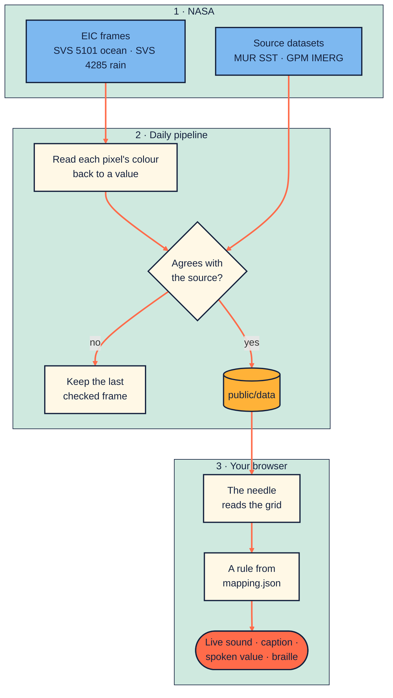
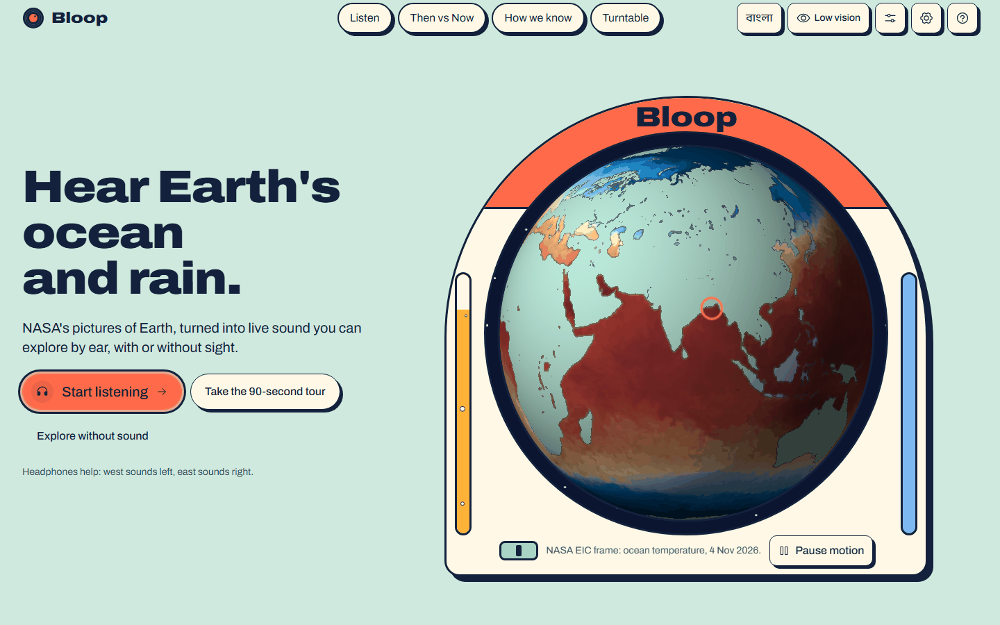
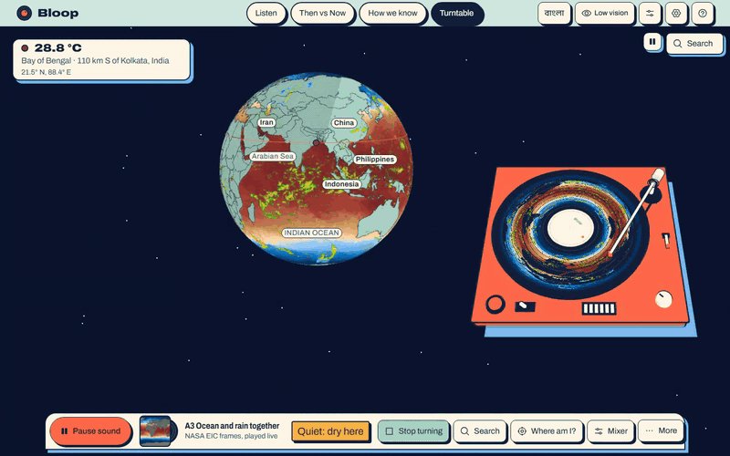
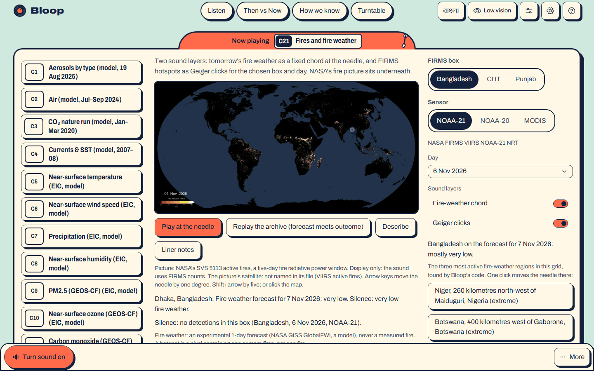
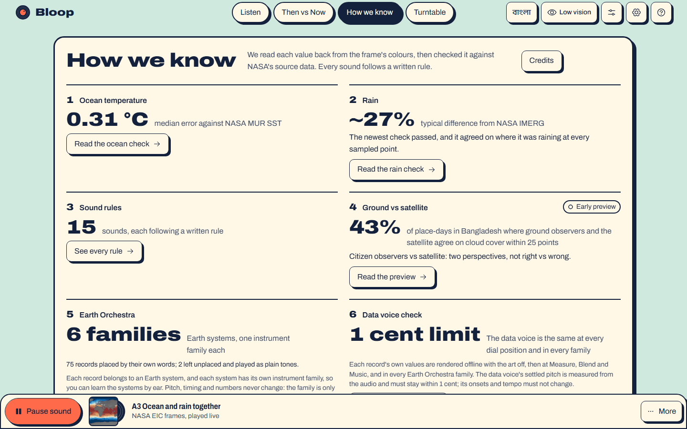
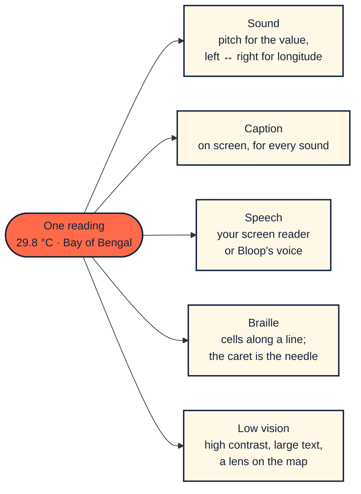
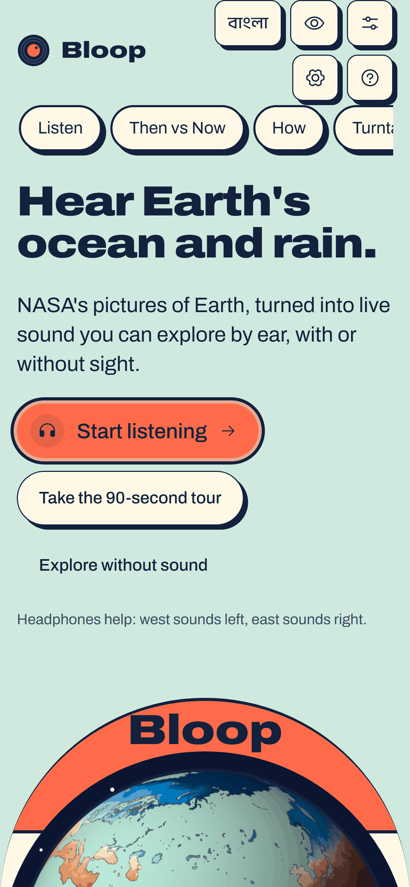
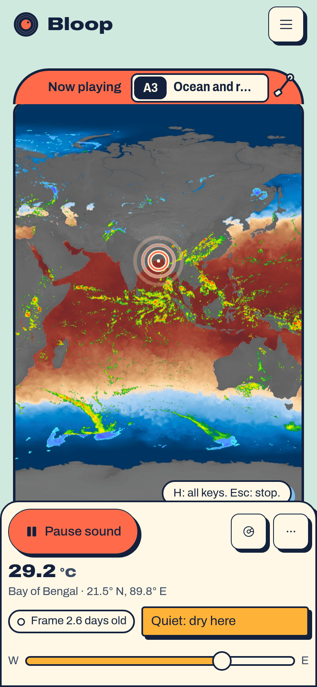

<div align="center">


<p>
  
  
  
  <br>
  
  
  
  
  
  
</p>

### Hear exactly what NASA's Earth Information Center is showing, and trust it.
Every sound traces back to a NASA measurement that we checked.

[How it works](#how-a-pixel-becomes-a-sound) · [Inside the jukebox](#inside-the-jukebox) · [Ways to listen](#ways-to-listen) · [Accessibility](#made-to-be-heard) · [Run it](#run-it) · [Credits](#credits)

</div>

<br>

<div align="center">
  
  <br>
  <sub><b>"Close your eyes."</b> Today's real ocean and rain as sound, then the jukebox opens onto NASA's frame.</sub>
</div>

<br>

## The idea

NASA's Earth Information Center (EIC) publishes beautiful pictures of our planet, and they are for eyes only. Bloop takes **the exact EIC frame on screen**, today's sea surface temperature and the latest half-hourly rain, and reads each pixel's colour back into the value it stands for, using the frame's own colour bar. Those values become **sound, generated live** as you move a needle over the Earth. Then we **check the values against NASA's source data** and show how close they are.

Blind and low-vision people can explore the planet by ear with a keyboard, speech and braille. Everyone else hears patterns, like the monsoon moving over the Bay of Bengal.

> [!NOTE]
> **Why "Bloop"?** The name comes from [the Bloop](https://oceanservice.noaa.gov/facts/bloop.html), a mysterious underwater sound that NOAA's hydrophones recorded in the southern Pacific in 1997. In 2005 it was traced to an icequake: an iceberg cracking away from Antarctica. Like the Bloop, this project lets you learn about the ocean by listening to it.

## How a pixel becomes a sound


| Warmer ocean | More rain | Snow | West ↔ East | No data |
|:---:|:---:|:---:|:---:|:---:|
| a higher pitch | denser drops | soft bells | left ↔ right ear | silence and a short tick |

Every rule and number lives in one file, [`public/mapping.json`](public/mapping.json). The app explains each one in words, and **How we know** shows the checks.

### From NASA to your ears



## Inside the jukebox

<table>
  <tr>
    <td width="50%" valign="top">
      
      <h3>Home</h3>
      The window holds a globe of <b>today's NASA ocean frame</b>. Start listening, take the 90-second tour, or explore without sound.
    </td>
    <td width="50%" valign="top">
      
      <h3>Listen</h3>
      Move the needle with the arrow keys, a mouse or a finger. The ocean hums and rain falls as drops. Press <kbd>Enter</kbd> to hear the value and the place spoken. Over land it says so: <i>No ocean data here</i>.
    </td>
  </tr>
  <tr>
    <td width="50%" valign="top">
      
      <h3>Storm time-lapse</h3>
      The last <b>48 half-hourly IMERG rain frames</b> on a globe or a flat map. The needle follows the heaviest rain near Bangladesh, and each frame shows its own value and time.
    </td>
    <td width="50%" valign="top">
      
      <h3>Then vs Now</h3>
      <i>Dhaka in April–May: 1.37 °C warmer in 2016–2025 than in 1981–1990</i> (NASA GISTEMP). Heat, monsoon rain (GPCP, cross-checked with GPCC rain gauges) and the water underground (GRACE), for Dhaka, Chattogram, Rajshahi and Sylhet. The playhead follows the sound.
    </td>
  </tr>
  <tr>
    <td width="50%" valign="top">
      
      <h3>Turntable</h3>
      The Earth and a turntable side by side, and the record <i>is</i> the Earth. Click the globe or the record to drop the needle. Search a place, ask "Where am I?", or open the 3D scenes: Ghost Earths, the playable delta, Sound terrain and the Dhaka time tunnel.
    </td>
    <td width="50%" valign="top">
      
      <h3>Official records</h3>
      NASA's Earth Information Center items and related SVS visualisations, each read back into values and played. They include fire weather with FIRMS fire detections as Geiger clicks, landslide exposure, night lights by city, and NASA's own sonification method.
    </td>
  </tr>
</table>

<div align="center">
  
  <br>
  <sub><b>How we know:</b> every number on the page comes from a check you can open and read.</sub>
</div>

### The record rack

Everything that plays is a record with a code, the way a jukebox works. Type a code on the **Records** key, or pick one from the rack.

| Shelf | Records |
|---|---|
| **A** · Live | `A0` How it sounds (the legend) · `A1` Ocean temperature · `A2` Rain and snow · `A3` Ocean and rain together |
| **B** · Then vs Now | `B1` Heat · `B2` Monsoon rain · `B3` Water underground · `B4` Fires · `B5` Vegetation (`B4`, `B5`: charts only) |
| **C** · Official records | NASA's EIC and SVS records, `C1` onwards, in the order of the official index |
| **D** · Guided | `D1` The tour · `D2` Storm time-lapse · `D3` Sweep from Chattogram |

## Ways to listen

**Earth Orchestra.** Each Earth system plays in its own instrument family, so you can learn the systems by ear. Pitch, timing and the numbers never change; only the instrument does.

| Ocean | Air and weather | Land and life | Fire and smoke | Ice and water storage | People and carbon |
|:---:|:---:|:---:|:---:|:---:|:---:|
| breathy flute<br><sub>a synthesised bansuri</sub> | soft, airy pad | plucked string<br><sub>a synthesised dotara</sub> | muted metallic pluck<br><sub>with a crackle</sub> | glassy bell | felt piano |

**The Science to Art dial.** *Measure*, *Blend* or *Music*. The further you turn it, the more musical Bloop sounds, but the data voice stays within **1 cent** of its pitch at every stop. A test on every record checks this.

**Ask Bloop.** Type a question or a command in English or Bangla, like *what is the temperature in Cox's Bazar*, *find the wettest place in the Bay of Bengal*, *compare August 2023 with March 2023* or *go to the turntable*. A parser reads it, and the answer comes from Bloop's own data, never from an AI. It is in Listen's **More** menu.

**Water's journey.** *A Bangladesh suite:* lightning, an atmospheric river, the rain over Bangladesh, landslide exposure on its hills, the water stored underground, and the Bay of Bengal. Each plays in its own family, with two seconds of silence between them.

**Data or choice?** Every record says which parts of the sound come from the data and which are our artistic choices.

## Made to be heard

Accessibility is the point of the project, not an extra. One reading reaches you in whichever way works for you:



| Key | What it does |
|---|---|
| <kbd>←</kbd> <kbd>→</kbd> <kbd>↑</kbd> <kbd>↓</kbd> | Move the needle 1° (with <kbd>Shift</kbd>, 10°) |
| <kbd>Enter</kbd> | Speak the value and the place |
| <kbd>Space</kbd> | Pause or resume the live sound |
| <kbd>1</kbd> <kbd>2</kbd> <kbd>3</kbd> | Ocean, rain, or both |
| <kbd>S</kbd> | The sweep outward from Chattogram |
| <kbd>D</kbd> · <kbd>C</kbd> | Describe mode · captions |
| <kbd>L</kbd> · <kbd>P</kbd> | Hear the legend · where this value comes from |
| <kbd>B</kbd> | Braille data explorer (Listen and Then vs Now) |
| <kbd>M</kbd> | Mute or unmute everything |
| <kbd>H</kbd> | Every key |
| <kbd>Esc</kbd> | Stop all sound and close panels, from anywhere |

- **Screen readers:** the map is one focusable region, and each move is said once. Letter keys work only while the map has focus, so they never clash with screen-reader keys.
- **Speech choices:** your screen reader, Bloop's built-in voice, or neither, never both at once. Descriptions come in brief, standard or detailed.
- **Low-vision mode:** high-contrast dark and light themes, a custom theme with a contrast warning, larger text and spacing, a calm view, and a Context Lens on the map.
- **Without sound:** "Explore without sound" shows every value as text and captions.
- **Reduced motion:** follows your system setting and the app's own. Every moving stage has a **Pause motion** key that stops the motion, never the sound.
- **English and বাংলা:** every string in the app has a Bangla version, under native-speaker review in [`docs/i18n/REVIEW.md`](docs/i18n/REVIEW.md).

<table>
  <tr>
    <td width="50%" align="center"></td>
    <td width="50%" align="center"></td>
  </tr>
  <tr>
    <td colspan="2" align="center"><sub><b>On a phone:</b> the same app, with 44 px touch targets and the player within thumb reach.</sub></td>
  </tr>
</table>

## Run it

You need [Bun](https://bun.sh).

```sh
bun install
bun run dev      # open http://localhost:3000
```

> [!TIP]
> Wear headphones: west sounds left, east sounds right. Browsers only start sound after a click, so press **Start listening**.

| Command | What it does |
|---|---|
| `bun run build` then `bun run start` | Static production build in `out/`, served at http://localhost:3000 |
| `bun run lint` | ESLint |
| `bunx tsc --noEmit` | Type check |
| `bun test` | Unit tests |
| `bun run e2e` | Browser checks (Playwright, Chromium and Firefox) |
| `npm run health` | Record health check: writes `docs/HEALTH.md` (Python and Playwright) |
| `npm run refresh:live` | Refreshes every updating record; ships only what passes its truth check |
| `bun run i18n:todo` | Rewrites `docs/i18n/TO_TRANSLATE.md`, the Bangla strings still to translate |

<details>
<summary><b>Feature flags</b></summary>

<br>

Features are switched in [`src/lib/flags.ts`](src/lib/flags.ts). A feature is on in production once it works in this design and its checks pass. Each flag also has a `NEXT_PUBLIC_*` variable that can override it, and `NEXT_PUBLIC_BLOOP_PREVIEW=1` shows every feature, ready or not.

</details>

<details>
<summary><b>Rebuilding the data (optional)</b></summary>

<br>

The data the app reads is already in `public/data/`, and GitHub Actions refresh it every day (`.github/workflows/data-daily.yml`). To rebuild it yourself you need Python, the packages in `pipeline/requirements.txt`, and a NASA Earthdata login:

```sh
cd pipeline
pip install -r requirements.txt
python run_all.py            # options: --no-sequence --no-context --with-global
```

</details>

<details>
<summary><b>Project layout</b></summary>

<br>

| Path | What it holds |
|---|---|
| `src/app/`, `src/components/`, `src/router/` | The web app (Next.js static export, React, shadcn/ui, TanStack Router) |
| `src/lib/records.ts` | Every playable thing, with its code: the rack, the player and the crowns all read it |
| `src/lib/audio/` | The sound engine (Web Audio); its public API is `@/lib/audio` |
| `src/lib/audio-adapter/` | The one place the interface connects to the sound engine |
| `src/lib/audio-jukebox/` | The second engine: Official records, the Turntable and its scenes |
| `src/lib/audio-engines.ts` | Where the two engines meet: one AudioContext, one Mute all and one Stop |
| `src/lib/art/` | Earth Orchestra, the Science to Art dial, Water's journey |
| `src/lib/earth/` | Fire weather, landslide exposure, night lights, NASA's radar method |
| `src/lib/ask-bloop/` | Ask Bloop's parser and answers |
| `src/a11y/`, `src/lib/low-vision/` | Descriptions, braille short forms, low-vision themes |
| `src/lib/data/` | Data loaders and the grid decoder |
| `src/lib/i18n/` | Every string, in English and Bangla |
| `public/mapping.json` | Every value-to-sound rule and tuned number |
| `public/data/` | The data files the app reads (grids, JSON) |
| `pipeline/` | Python scripts that build and check `public/data/` |

</details>

## Honesty rules

> [!IMPORTANT]
> - No number appears unless it comes from our data files or our tests.
> - The sound is generated live. The data is near real time, and the frame's time is always shown.
> - Comparisons use multi-year windows. Single years are labelled "example years".
> - A modelled or forecast record says so, and is never labelled as a measurement.
> - Anything not built yet is labelled "Planned".

## Credits

The credits are built from the record registry (`public/data/meta/freshness.json`, the Official and Related indexes, and the voices each page plays: `src/lib/credits/`), so they list every source a playing record uses, and only those. The app shows the same list on How we know, Official records, the Turntable and the Team page. It is grouped into Observations, Models and reanalyses, and NASA visualisations (SVS, with each record's IDs). Each entry gives the provider, the pages where it plays and a link. Sources we built and checked but don't play (GPCC, FIRMS, MODIS MOD13Q1, GLOBE and others) are listed separately as "Used in our testing (not playable)". NASA POWER was checked and dropped, because it disagreed with independent records.

We follow each dataset's own acknowledgement text where one is provided (for example GRACE and GPCP).

**Partner agencies:** IMERG comes from the joint NASA–JAXA GPM mission. MUR includes JAXA AMSR2 and EUMETSAT sea-ice inputs. GPCC is from Germany's national weather service (Deutscher Wetterdienst).

**Audio:** all sound is generated by our code. There is no third-party music, and there are no samples.

## Licence

Open source under the [MIT License](LICENSE), © 2026 Team PTSD, as the NASA Space Apps Challenge asks for public, reusable code.

## Use of AI

AI tools helped with coding and writing. AI never produces the numbers you see or hear: every value comes from NASA data, read by our code.
